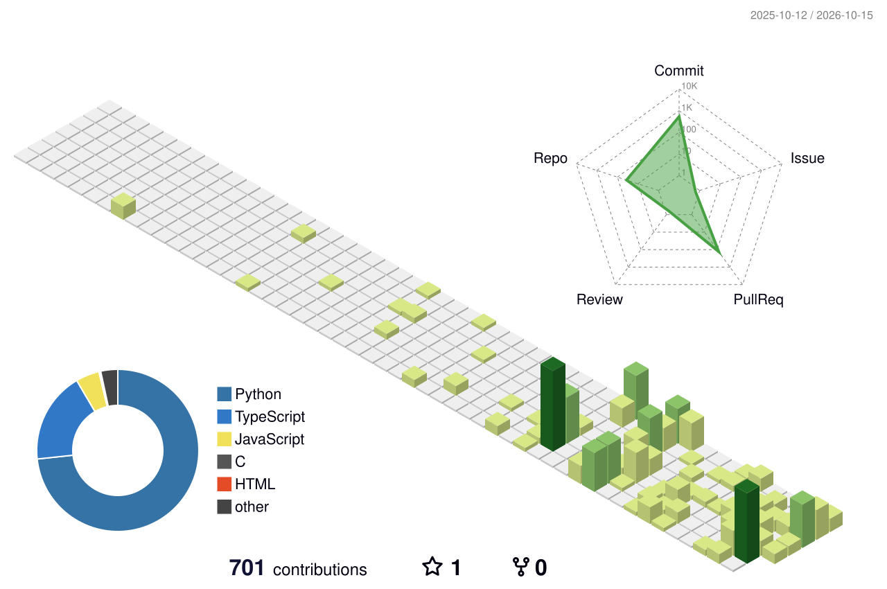

### Computer Science · AI · Full-Stack · Cloud & Developer Tools

   

---

## About Me

- **AI Builder** → Practical AI products, automation, and intelligent workflows.
- **Full-Stack Developer** → React / JavaScript on the front, Node.js and APIs on the back.
- **Backend Engineer** → Clean services, integrations, databases, and developer tooling.
- **Cloud & DevOps** → Docker, Linux, GitHub Actions, and reliable deployments.
- **Currently** → Building, learning, and shipping in public.

> I like building software that is useful, understandable, and reliable — less demo, more product.

---

## Tech Stack & Tools

| Area | Focus |
| --- | --- |
| AI / Data | LLM applications, RAG, agents, embeddings, evaluation |
| Backend | Python, FastAPI, Node.js, REST APIs, PostgreSQL, Redis |
| Frontend | JavaScript, React, Next.js, responsive interfaces |
| Engineering | Docker, Linux, GitHub Actions, Vercel, CI/CD |

---

## My GitHub Analytics

 

---

## Featured Projects

| Project | Description | Link |
| --- | --- | :---: |
| **Self-Improving Multi-Agent RAG System** | Self-improving multi-agent retrieval and generation system. | [Repo](https://github.com/ankitbuilds99/Self-Improving-Multi-Agent-RAG-System) |
| **EraserOPS** | Agentic operations and incident-management tooling. | [Repo](https://github.com/ankitbuilds99/EraserOPS) |
| **Git for Research** | Git-based workflow and tooling for research projects. | [Repo](https://github.com/ankitbuilds99/Git-for-research) |
| **Proxime** | AI conversation and interaction platform. | [Repo](https://github.com/ankitbuilds99/Proxime) |
| **TigerGraph Agentic Fraud Investigation** | Agentic fraud investigation powered by TigerGraph. | [Repo](https://github.com/ankitbuilds99/TigerGraph-Agentic-Fraud-Investigation-HHGOA) |

---

## My Contributions · 3D Visualization

  

*Generated automatically from my contribution history by GitHub Actions.*

---

## Terminal Mode

whoami

Ankit Pandey | AI Builder & Software Engineer

pwd

~/work/software-and-ai

ls

AI/ · Full-Stack/ · Backend/ · Cloud/ · Developer-Tools/

cat focus.txt

Build useful products. Keep learning. Ship with intent.

---

## Let's Connect

📧 [ankitpandey5747906@gmail.com](mailto:ankitpandey5747906@gmail.com) · 💼 [LinkedIn](https://www.linkedin.com/in/ankit-pandey-5a28b9379/) · 🐙 [GitHub](https://github.com/ankitbuilds99)

**Build useful things. Keep learning. Ship with intent.**

